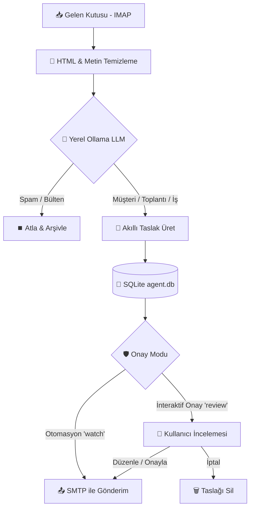

<div align="center">

# 🤖 Autonomous AI Email Agent
### Yerel LLM Destekli, Güvenli ve Otonom E-posta Asistanı

[](https://python.org)
[-purple?style=for-the-badge&logo=ollama)](https://ollama.ai)
[](LICENSE)
[]()

<br>


<p align="center">
  <b>Gelen e-postalarınızı yerel yapay zeka (Ollama) ile tamamen kendi cihazınızda analiz eden, akıllıca sınıflandıran ve insan onaylı/otonom yanıt taslakları üreten açık kaynaklı e-posta otomasyonu.</b>
</p>

</div>

---

## 📽️ Canlı Terminal Demosu

Aşağıdaki animasyonda ajanın okunmamış e-postaları taraması, `qwen2.5:7b` modeli ile analiz etmesi, taslak yanıt üretmesi ve interaktif `review` ekranında kullanıcı onayından geçerek e-postayı göndermesi simüle edilmektedir:


<details>
<summary>▶️ <b>Yüksek Çözünürlüklü Demo Videosunu İzleyin (assets/demo.mp4)</b></summary>

https://github.com/user-attachments/assets/demo.mp4

*(Not: MP4 formatındaki yüksek kaliteli video dosyasına [`assets/demo.mp4`](assets/demo.mp4) üzerinden de doğrudan erişebilirsiniz.)*
</details>

---

## 🌟 Öne Çıkan Özellikler

- **🔒 %100 Veri Gizliliği (Zero Cloud Leaks):** E-posta içerikleriniz OpenAI veya Google gibi harici bulut API'lerine gitmez. Tüm çıkarımlar yerel bilgisayarınızda çalışan **Ollama** modelleri ile işlenir.
- **🏷️ Akıllı Sınıflandırma (Zero-Shot Classification):** Gelen iletileri türlerine göre otomatik etiketler (`lead`, `meeting`, `support`, `newsletter`, `spam`).
- **✍️ Bağlama Duyarlı Yanıt Taslakları:** Gelen e-postanın diline, kurumsal tonuna ve geçmiş yazışma bağlamına göre profesyonel taslaklar oluşturur.
- **🛡️ İnsan Denetimi (Human-in-the-Loop) & DRY_RUN:** Varsayılan olarak `DRY_RUN=true` modunda çalışır; siz onaylamadan veya komut vermeden hiçbir e-posta asla yanlışlıkla gönderilmez.
- **📬 Otomatik Takip Sistemi (Follow-ups):** Yanıt alamadığınız önemli iş e-postalarını SQLite üzerinde takip eder, belirlediğiniz gün aralığında nazik takip taslakları hazırlar.
- **🔄 Watch Daemon Modu:** Arka planda periyodik olarak çalışarak gelen kutunuzu sürekli dinler ve takip maillerini yönetir.
- **📊 SQLite & Denetim Günlüğü:** Her işlem `agent.db` ve `agent.log` dosyalarında kayıt altına alınır; hiçbir e-posta çift işlenmez.

---

## 🖥️ İş Akışı ve Dashboard




---

## 🚀 Hızlı Başlangıç & Kurulum

### 1. Gereksinimler
- Python 3.10 veya üzeri
- Bilgisayarınızda kurulu ve çalışan [Ollama](https://ollama.ai)

### 2. Depoyu Klonlayın
```bash
git clone https://github.com/erenburakkayaer/Custom-AI-Agent-for-Email.git
cd Custom-AI-Agent-for-Email
```

### 3. Bağımlılıkları Yükleyin
```bash
python3 -m venv venv
source venv/bin/activate   # Windows: venv\Scripts\activate
pip install -r requirements.txt
```

### 4. Yerel Yapay Zeka Modelini İndirin
Ollama üzerinde önerilen varsayılan model:
```bash
ollama pull qwen2.5:7b
# alternatif daha hafif modeller:
# ollama pull llama3.2:3b
# ollama pull mistral:7b
```

### 5. Ortam Değişkenlerini Yapılandırın
```bash
cp env.example .env
```
`.env` dosyasını kendi e-posta ve sunucu bilgilerinize göre doldurun.

---

## ⚙️ Yapılandırma (.env)

| Değişken | Açıklama | Varsayılan |
| :--- | :--- | :--- |
| `IMAP_HOST` | E-posta okuma sunucusu | `imap.gmail.com` |
| `SMTP_HOST` | E-posta gönderme sunucusu | `smtp.gmail.com` |
| `SMTP_PORT` | SMTP portu | `465` (SSL) |
| `EMAIL_USER` | E-posta adresiniz | `ornek@gmail.com` |
| `EMAIL_PASS` | Gmail **Uygulama Şifresi** (App Password) | `xxxx xxxx xxxx xxxx` |
| `OLLAMA_MODEL` | Kullanılacak yerel model | `qwen2.5:7b` |
| `DRY_RUN` | Gerçek gönderimi kapatır (Test modu) | `true` |
| `TONE` | Yanıt üslubu yönergesi | `Kibar, net ve profesyonel ol...` |
| `POLL_MINUTES` | Watch modu tarama sıklığı | `10` |
| `FOLLOWUP_AFTER_DAYS`| Takip e-postası için bekleme günü | `3` |

> 💡 **Gmail Kullanıcıları İçin Önemli:** Normal Gmail şifreniz yerine Google Hesabınızda **2 Adımlı Doğrulama**'yı açıp [Uygulama Şifreleri (App Passwords)](https://myaccount.google.com/apppasswords) bölümünden 16 haneli bir şifre almanız gerekmektedir.

---

## 📖 Kullanım Kılavuzu

Uygulamayı çalıştırmak için `gmail_otomation.py` betiğini ilgili komut ile tetikleyin:

### 1. Okunmamış Mailleri Tara & Taslak Üret
Gelen kutunuzdaki yeni iletileri çeker, yerel yapay zeka ile inceler ve taslak yanıtları SQLite kuyruğuna kaydeder:
```bash
python gmail_otomation.py scan
```

### 2. Taslakları İncele & Onayla (Review)
Oluşturulan taslakları terminalde tek tek görüntüleyin; düzenleyin, onaylayıp gönderin veya atlayın:
```bash
python gmail_otomation.py review
```

### 3. Cevapsız Kalan E-postaları Takip Et (Followups)
Belirlenen süre boyunca yanıt alamadığınız önemli görüşmeler için nazik hatırlatma taslakları hazırlar:
```bash
python gmail_otomation.py followups
```

### 4. Kısa Not ile Sıfırdan E-posta Yazdır (Compose)
Konu ve kısa bir talimat vererek yapay zekaya profesyonel bir e-posta yazdırın:
```bash
python gmail_otomation.py compose --to "musteri@firma.com" --brief "Gelecek haftaki demo toplantımızın gününü teyit et"
```

### 5. Sürekli İzleme Modu (Daemon Watch)
Arka planda belirlediğiniz aralıklarla (`POLL_MINUTES`) sürekli gelen kutusunu tarar ve takip e-postalarını hazırlar:
```bash
python gmail_otomation.py watch
```

### 6. Durum & Metrikleri Görüntüle
Bekleyen taslak sayısı, gönderilen mailler ve genel performansı listeler:
```bash
python gmail_otomation.py status
```

---

## 📂 Proje Yapısı

```
Custom_AI_Agent_for_Email/
├── assets/
│   ├── banner.png               # GitHub Vitrin Banner Görseli
│   ├── workflow_dashboard.png   # Terminal & Dashboard Mockup Görseli
│   ├── demo.gif                 # Terminal İş Akışı Animasyonu
│   └── demo.mp4                 # Yüksek Kaliteli Terminal Demo Videosu
├── gmail_otomation.py           # Ana Ajan Motoru & CLI Komutları
├── requirements.txt             # Python Bağımlılıkları
├── env.example                  # Örnek Çevre Değişkenleri
├── .gitignore                   # Hassas Dosyaları Korumak İçin Ayarlar
└── README.md                    # Proje Dokümantasyonu
```

---

## 🤝 Katkıda Bulunma

1. Depoyu Fork'layın (`Fork`)
2. Yeni bir özellik dalı oluşturun (`git checkout -b feature/YeniOzellik`)
3. Değişikliklerinizi commit'leyin (`git commit -m 'feat: yeni özellik eklendi'`)
4. Dalınıza push edin (`git push origin feature/YeniOzellik`)
5. Bir **Pull Request** açın

---

## 📄 Lisans

Bu proje [MIT Lisansı](LICENSE) kapsamında lisanslanmıştır.
