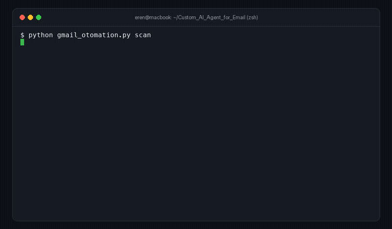
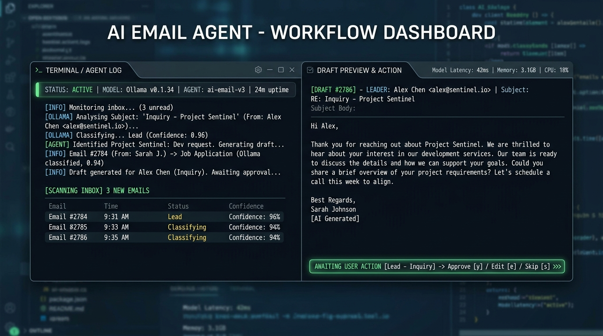
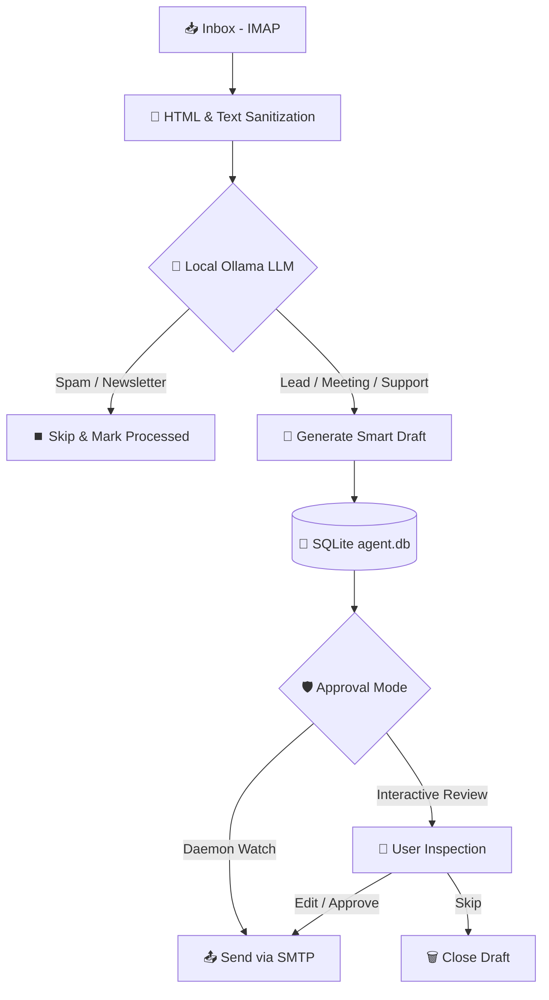

<div align="center">

# 🤖 Autonomous AI Email Agent
### Local LLM-Powered, Privacy-First Autonomous Email Assistant

[](https://python.org)
[-purple?style=for-the-badge&logo=ollama)](https://ollama.ai)
[](LICENSE)
[]()

<br>


<p align="center">
  <b>An open-source email automation agent that analyzes incoming emails with local AI (Ollama), intelligently categorizes messages, and generates human-reviewed or autonomous reply drafts directly on your local machine.</b>
</p>

</div>

---

## 📽️ Live Terminal Demo

The animation below demonstrates the agent scanning unread emails, analyzing content using the `qwen2.5:7b` model, drafting intelligent replies, and sending emails through an interactive `review` approval workflow:



<details>
<summary>▶️ <b>Watch High-Definition Demo Video (assets/demo.mp4)</b></summary>

https://github.com/user-attachments/assets/demo.mp4

*(Note: You can also access the full-quality MP4 file directly at [`assets/demo.mp4`](assets/demo.mp4).)*
</details>

---

## 🌟 Key Features

- **🔒 100% Data Privacy (Zero Cloud Leaks):** Your email contents never leave your machine. No external cloud APIs (like OpenAI or Google) receive your data. All inferences run locally via **Ollama**.
- **🏷️ Intelligent Classification (Zero-Shot):** Automatically classifies incoming emails into actionable categories (`lead`, `meeting`, `support`, `newsletter`, `spam`).
- **✍️ Context-Aware Reply Drafts:** Crafts professional responses tailored to the language, business tone, and context of the conversation.
- **🛡️ Human-in-the-Loop & DRY_RUN Safety:** Operates in `DRY_RUN=true` mode by default; no emails are ever sent without your explicit review and confirmation.
- **📬 Automated Follow-up Tracking:** Tracks important outgoing threads in SQLite and automatically prepares polite follow-up drafts if no reply is received after a customizable threshold.
- **🔄 Watch Daemon Mode:** Continuously polls your inbox at configured intervals to handle incoming messages and follow-up schedules.
- **📊 SQLite Audit Trail:** Every action and message state is reliably tracked in `agent.db` and logged in `agent.log` to prevent duplicate processing.

---

## 🖥️ Workflow & Architecture





---

## 🚀 Quickstart & Installation

### 1. Prerequisites
- Python 3.10+
- [Ollama](https://ollama.ai) installed and running locally

### 2. Clone the Repository
```bash
git clone https://github.com/erenburakkayaer/Custom-AI-Agent-for-Email.git
cd Custom-AI-Agent-for-Email
```

### 3. Install Dependencies
```bash
python3 -m venv venv
source venv/bin/activate   # Windows: venv\Scripts\activate
pip install -r requirements.txt
```

### 4. Pull the Local LLM Model
Default recommended model:
```bash
ollama pull qwen2.5:7b
# Lightweight alternatives:
# ollama pull llama3.2:3b
# ollama pull mistral:7b
```

### 5. Configure Environment Variables
```bash
cp env.example .env
```
Fill in your email credentials and configuration settings in `.env`.

---

## ⚙️ Configuration (.env)

| Variable | Description | Default |
| :--- | :--- | :--- |
| `IMAP_HOST` | IMAP server host | `imap.gmail.com` |
| `SMTP_HOST` | SMTP server host | `smtp.gmail.com` |
| `SMTP_PORT` | SMTP port | `465` (SSL) |
| `EMAIL_USER` | Your email address | `user@gmail.com` |
| `EMAIL_PASS` | Gmail **App Password** | `xxxx xxxx xxxx xxxx` |
| `OLLAMA_MODEL` | Local LLM model tag | `qwen2.5:7b` |
| `DRY_RUN` | Simulated sending mode (safety flag) | `true` |
| `TONE` | Reply tone and persona instructions | `Write politely, clearly, and concisely...` |
| `POLL_MINUTES` | Daemon polling interval (minutes) | `10` |
| `FOLLOWUP_AFTER_DAYS`| Inactivity days before scheduling follow-up | `3` |

> 💡 **Important for Gmail Users:** Do not use your regular account password. Enable **2-Step Verification** on your Google Account and generate a dedicated 16-character password from [Google App Passwords](https://myaccount.google.com/apppasswords).

---

## 📖 CLI Usage

Execute the agent via `gmail_otomation.py` with the desired command:

### 1. Scan Unread Emails & Generate Drafts
Fetches unread messages, classifies them using local AI, and queues drafts in SQLite:
```bash
python gmail_otomation.py scan
```

### 2. Review & Approve Drafts Interactively
Inspect pending drafts in terminal; edit, approve and send, or skip:
```bash
python gmail_otomation.py review
```

### 3. Generate Follow-up Reminders
Identifies tracked threads with no response and generates non-pushy follow-up drafts:
```bash
python gmail_otomation.py followups
```

### 4. Compose a New Email from a Brief
Quickly draft a new professional email given a recipient and a brief objective:
```bash
python gmail_otomation.py compose --to "client@company.com" --brief "Confirm demo meeting schedule for next Wednesday"
```

### 5. Continuous Daemon Watch Mode
Runs scanning and follow-up loops continuously in the background at scheduled intervals:
```bash
python gmail_otomation.py watch
```

### 6. View System Metrics & Status
Displays counts of pending drafts, sent emails, and waiting threads:
```bash
python gmail_otomation.py status
```

---

## 📂 Project Structure

```
Custom_AI_Agent_for_Email/
├── assets/
│   ├── banner.png               # GitHub repository showcase banner
│   ├── workflow_dashboard.png   # Terminal & architecture mockup preview
│   ├── demo.gif                 # Terminal workflow preview animation
│   └── demo.mp4                 # High-definition terminal demo video
├── gmail_otomation.py           # Main agent engine & CLI interface
├── requirements.txt             # Python dependencies
├── env.example                  # Environment configuration template
├── .gitignore                   # Ignore rules for credentials and caches
└── README.md                    # Project documentation
```

---

## 🤝 Contributing

1. Fork the repository (`Fork`)
2. Create your feature branch (`git checkout -b feature/AmazingFeature`)
3. Commit your changes (`git commit -m 'feat: add amazing feature'`)
4. Push to the branch (`git push origin feature/AmazingFeature`)
5. Open a **Pull Request**

---

## 📄 License

This project is licensed under the [MIT License](LICENSE).
